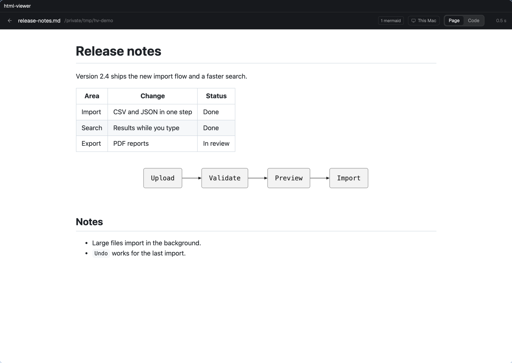

# html-viewer

A [Herdr](https://herdr.dev) tab that shows HTML and Markdown files as real pages, Mermaid diagrams included, on whichever machine the file lives.



- Headless Chrome draws the page on the file's machine (this computer or one added with `hc machine add`) and the picture comes back to the tab in tiles, the first screen first. One Chrome per machine stays open while you use it and closes after 3 idle minutes or when the last viewer closes.
- Page / Code: the source in Herdr's read-only editor, with line numbers and syntax colors.
- Without a file: search, recent files, and the space's `.html` and `.md` files by folder.
- Markdown goes through [marked](https://marked.js.org) 18.1.1; ```` ```mermaid ```` blocks, and `pre.mermaid` in HTML, are drawn with [pele](https://www.npmjs.com/package/pele) 1.12.0. Both are pinned by version and SHA-256 and cached in `~/.cache/herdr-html/`.
- Paste any path: with `~`, relative to the space, quoted, as a `file://` URL, with escaped spaces or with the period that ended a sentence.
- It redraws when the file changes or the pane changes width.

## Install

```sh
git clone https://github.com/frizynn/html-viewer
cp -R html-viewer/mods/html-viewer ~/.config/herdr-app/mods/
```

Open it as a tab of the current space:

```sh
herdr-app do tab.new '{"mod":"html-viewer","props":{"space":"<space id>","file":"~/notes/report.md"}}'
```

`space` tells the viewer which machine to use (a remote space's id starts with its machine's name); without it, it uses the space shown when the tab first appears. Without `file` it lists the space's `.html` and `.md` files.

Needs Node 22 or newer and Chrome (or Chromium, or a Playwright headless shell; `HTML_CHROME` picks one) on each machine that has files to show. It runs `node` and Chrome there (on Linux with systemd, as a `systemd-run --user` unit), reads the files you open, and downloads marked and pele from jsDelivr once.

`RECIPE.md` is the brief to rebuild it from scratch.
