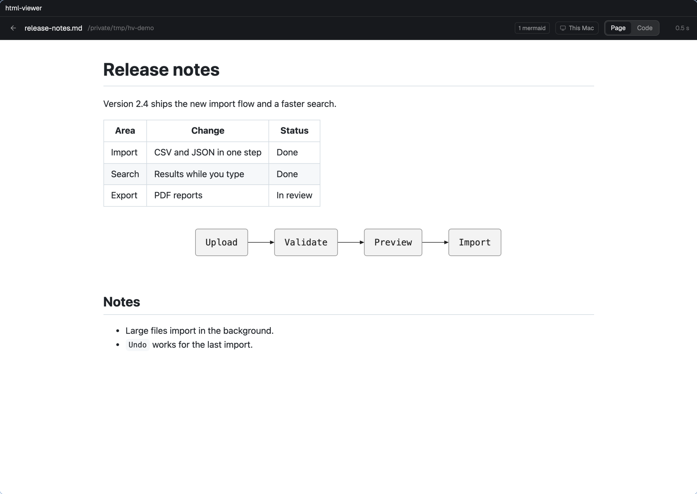

# html-viewer

A tab that shows an HTML or Markdown file as the page Chrome draws, or its source, from the machine where the file is, with Mermaid diagrams drawn. 

**What you see:** without a file, a 42px header ("HTML viewer" semibold, the space's folder in `dim`, a machine chip with a monitor or server icon and "This Mac" or the machine's name), a 36px search field with an `accent` border, then a scrolling list: "Recent" (this machine's last 8 opened files) and the space's `.html` and `.md` files grouped under folder headings (11.5px `dim`), 28px rows with a file or Markdown icon, hover `hover`. Loading shows a spinning ring and "Looking for .html and .md files in <folder>…"; an error shows in `blocked` with a "Try again" button; no files says so and points to the search field; more than 80 rows end with "N more: type to narrow the list". With a file: a 42px header (back arrow, file name semibold, its folder in `dim`, "N mermaid" chip when the page had diagrams, the machine chip, a Page / Code segmented control, and at the right a spinner with "loaded/total" tiles while drawing, the seconds the first tile took once done, or a `blocked` dot on error). Below, the page on white, in tiles stacked at the pane's width, scrolling vertically; or the source in the read-only code editor with line numbers and syntax colors from the theme.

**How it behaves:** typing filters recent and listed files by path; Enter opens the first match, or the text as a path when it starts with `/`, `~`, `./`, `file://` or a quote, or when nothing matches. A pasted path is tried as written, then without quotes, backticks, escaped spaces or a final `.,;:!?)`; relative paths start at the space's folder. Every 2 s it asks the file's change time and redraws when it changed or the pane's width moved more than 40 px; the source view reloads too. Pages taller than 60000 px are cut with a note.

**Built from:** a pane mod (`mod.json` `{"place":"none","title":"html-viewer"}`), opened with `tab.new {space, mod: "html-viewer", props: {space, file?, view?: "page" | "code"}}`. `render.mjs` runs on the file's machine through `exec("node", ["--input-type=module", "-e", source, "herdr-html", command, ...], {on: machine})`: `resolve`, `stat`, `list`, `show` (lay out and send tile 0), `tile`, `stop`. A background copy of it (`serve`) owns one headless Chrome per machine, listens on `~/.cache/herdr-html/chrome.sock`, keeps the last 4 pages laid out at full height (device scale 2), and exits after 3 idle minutes or when the last viewer closes. Markdown goes through marked 18.1.1 inside the page, ```` ```mermaid ```` and `pre.mermaid` through pele 1.12.0, both pinned by SHA-256. Tiles are 1200 CSS px PNGs; from another machine they come as raw bytes through `sh -c 'hc exec --on <machine> … - > file'`. Source: `readTextFile(path, {on})` into `EditorState.new({language: "html" | "markdown", readonly: true})`. Recent files live in shared `html-viewer.recent`.

**Watch out:** a mod pane never learns its own pane or tab, so the opener passes the space; without it the viewer takes the space shown when it first starts. A script render is cut off at about 50 ms, so the start screen draws at most 80 rows. herdr-core runs a remote exec in a systemd service and kills whatever is left when it ends, and systemd-run expands `$` in arguments, so the background worker is written to `~/.cache/herdr-html/worker-<hash>.mjs` and started with `systemd-run --user`. The app's `exec` mangles binary output and `readTextFile` stops at 1 MiB: route PNGs through a shell redirect. Keep pictures in a hidden folder (`.cache`) and give each render its own path, since the app reloads a mod on visible file changes and caches images by path. Without `--disable-crash-reporter`, Chrome's crash handler outlives it and a remote exec never returns. On Ubuntu prefer the system Google Chrome: Playwright's headless shell has no sandbox there. Don't block every URL containing "mermaid": that blocks a file named after it. A worker that writes a PNG to a pipe must wait for stdout to drain before `process.exit`, or the image arrives cut at 64 KB. `on_size_change` reports the pane in screen points while style lengths get the app's `settings().zoom` on top, so divide the width by the zoom before asking Chrome for it.

**Done when:** a local `.html`, a local `.md` with a mermaid block and a `.md` on another machine each show as a page with the right machine chip; a path pasted with a final period opens; Code shows the source with line numbers; a 20000 px page shows its first screen in well under a second here; closing the last viewer leaves no `herdr-html serve` or Chrome process; `herdr-app check mods/html-viewer` passes.
